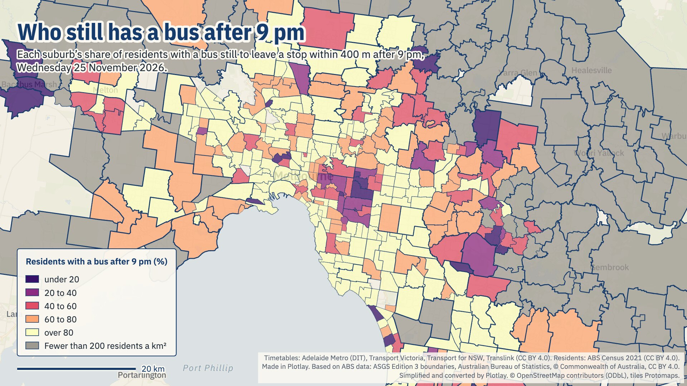

# The last bus of the evening

When does the last bus leave your street? Greater Adelaide, Melbourne, Sydney and Brisbane on an ordinary weekday evening, suburb by suburb, from each operator's published timetable. For every resident (ABS Census 2021, by mesh block) we found the latest bus to leave a stop within 400 m of home. **Live version, with an interactive map that steps through the evening:** [getplotlay.com/showcase/last-bus](https://www.getplotlay.com/showcase/last-bus/)



**In Greater Melbourne, 73.0% of residents have a bus still to come within 400 m after 9 pm on a weekday, and 47.9% after 10 pm.** For about 1.23 million people, the last bus from any stop near home leaves in that one hour. In the other three cities the same hour takes between 2.3% and 8.8% of residents. Sydney keeps its buses latest. In Brisbane, fewer than half the residents have a bus after 9 pm.

The suburbs, the charts, the map pictures and the video were made in [Plotlay](https://www.getplotlay.com): the table of SAL codes linked to an empty data layer, the official areas made from the codes, sparse suburbs left out by a column of the table, and Melbourne's buses in Vehicles moving with each route lit until its last service.

[](https://app.plotlay.io/?example=last-bus&as=client)

## Read this first

- **The timetable, not what ran.** Every figure comes from the timetables published for Wednesday 25 November 2026 (an ordinary school-term weekday) and Sunday 29 November 2026. Late running, cancellations and replacement buses are not in it.
- **Buses only.** Trains, trams, light rail and ferries are left out of the headline numbers; `numbers.json` has every mode for comparison.
- **School and on-demand services left out** where the feed marks them (Adelaide Metro's and Transport for NSW's feeds do). Transport Victoria's and Translink's feeds do not mark school services, so any in them are counted; they run in the day and do not change who has a bus after 7 pm.
- **400 m in a straight line** from the middle of each mesh block (the mean of its outline's points), not along streets.
- **Any bus, either direction.** A resident has a bus still to come if any bus leaves a stop within 400 m after the time. A terminus where buses only arrive is not a departure.
- **Up to 3 am.** The timetables were read from 3 am to 3 am the next day, so all-night buses count as running at 3 am.
- **Residents** are 2021 Census counts for the mesh blocks of each Greater Capital City Statistical Area.

## The numbers

Weekday (Wednesday 25 November 2026), buses only, share of each city's residents:

| City | Residents | No bus stop within 400 m | Bus after 9 pm | after 10 pm | after 11 pm | Sunday, after 9 pm | Any mode, after 9 pm |
|---|---|---|---|---|---|---|---|
| Sydney | 5,230,011 | 7.0% | 80.7% | 71.9% | 61.7% | 66.9% | 81.5% |
| Adelaide | 1,386,882 | 13.9% | 73.6% | 71.2% | 62.2% | 71.0% | 75.8% |
| Melbourne | 4,917,585 | 18.9% | 73.0% | 47.9% | 26.4% | 69.0% | 77.8% |
| Brisbane | 2,526,210 | 23.6% | 43.1% | 36.1% | 31.6% | 26.5% | 44.8% |

"No bus stop within 400 m" counts stops with any bus that day. Every number on the page is in `data/numbers.json`.

## What's here

| Folder | What |
|---|---|
| [`data/`](data) | `stops_<city>_<day>.csv`: every stop with a bus on the day, its first and last departure (clock and hours after midnight) and its departures. `mesh_blocks_<city>.csv`: every mesh block with residents, its middle, the stops within 400 m and the latest last bus among them (weekday and Sunday, buses and every mode). `suburbs.csv`: the mesh blocks added up by ABS suburb and locality (the share of residents with a bus still to come after 7, 8, 9, 10 and 11 pm and midnight, and the time by which half the residents' last bus has gone). `suburbs.geojson`: the 2,380 suburbs of 100 or more residents with their figures. `curve.csv`: each city's share every 10 minutes from 5 pm to 2 am. `cities.json`, `numbers.json`: the city totals and every number on the page. |
| [`data/powerbi/`](data/powerbi) | Flat tables for Power BI: `suburbs.csv` keyed by `sal_code`, `cities.csv`, `curve.csv` with a time column, `suburbs.topojson` for the Shape Map, `suburbs_wkt.csv` (outlines as WKT, with centres) for Azure Maps |
| [`powerbi/`](powerbi) | A Power BI Project (`LastBus.pbip`): the four cities' evening and the suburbs after 9 pm, one Shape Map per city. Open it with [`OPEN-ME.md`](powerbi/OPEN-ME.md) |
| [`python/`](python) | The notebook that gets the numbers and the maps again from `data/` ([`last_bus.ipynb`](python/last_bus.ipynb)); `suburbs.py`, which added the mesh blocks up by suburb; and, for reference, `hours.mjs`, which read the timetables with Plotlay's engine (not included here) |
| [`visuals/`](visuals) | The maps and charts, made in Plotlay |

### Run the notebook

```
python3 -m venv .venv
.venv/bin/pip install -r python/requirements.txt
cd python && ../.venv/bin/jupyter lab last_bus.ipynb
```

### Power BI

Open `powerbi/LastBus.pbip` in Power BI Desktop and select Refresh; [`powerbi/OPEN-ME.md`](powerbi/OPEN-ME.md) has the steps and the numbers it should show. It reads the tables below from this repository on GitHub, or from a local copy.

To build your own: load `data/powerbi/suburbs.csv` for the suburbs and `curve.csv` for the evening (its `time_of_evening` column runs from 17:00 to 02:00; sort it by `minutes_after_5pm` so 00:00 follows 23:50). For a filled map, use the Shape Map with `suburbs.topojson` as a custom map (its key is the SAL code), or Azure Maps with the outlines in `suburbs_wkt.csv`.

## How it was made

1. **The timetables**: each operator's GTFS feed, read for each day in three windows (3 am to 11 am, 11 am to 7 pm, 7 pm to 3 am) within each Greater Capital City's box, buses alone and every mode.
2. **First and last bus at each stop**: the first and last departure, a terminus where buses only arrive not counted, school and on-demand services left out where marked; stops kept within about 1 km of a mesh block with residents.
3. **Each mesh block**: the latest last bus and the earliest first bus of the stops within 400 m of its middle.
4. **Each suburb and city**: the residents added up (`suburbs.py`): the share with a bus still to come after each hour, and the curve.
5. **In Plotlay**: the suburbs' table linked to an empty data layer by SAL code, Make the areas for me, the magma palette by hand at 20, 40, 60 and 80%, sparse suburbs (fewer than 200 residents a km²) left out in grey by a column of the table, charts and map pictures on the Analysis page; Melbourne's feed read in the browser and played in Vehicles moving.

## Sources and licences

- Adelaide Metro GTFS: Department for Infrastructure and Transport, South Australia, via [Data.SA](https://data.sa.gov.au), CC BY 4.0.
- Transport Victoria GTFS schedule, via [DataVic](https://discover.data.vic.gov.au), CC BY 4.0.
- Transport for NSW timetables (complete GTFS), via the [Open Data Hub](https://opendata.transport.nsw.gov.au), CC BY 4.0.
- Translink SEQ GTFS: Department of Transport and Main Roads, Queensland, via the [Open Data Portal](https://www.data.qld.gov.au), CC BY 4.0.
- Census of Population and Housing 2021 mesh block counts; Mesh Blocks, Suburbs and Localities and Greater Capital City Statistical Areas 2021 (ASGS Edition 3): Australian Bureau of Statistics, CC BY 4.0.

The data in `data/` is licensed under CC BY 4.0 (`LICENSE-DATA`). The pictures in `visuals/` are CC BY 4.0 too; their base map is © OpenStreetMap contributors (ODbL). The code is MIT (`LICENSE`). See `NOTICE`.

This is independent work using open data, not endorsed by any of the transport agencies or the ABS.
